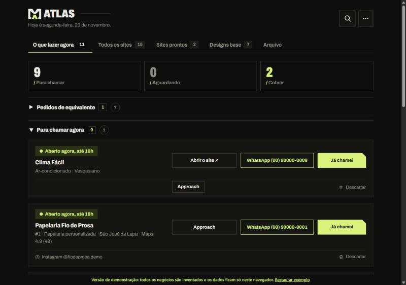
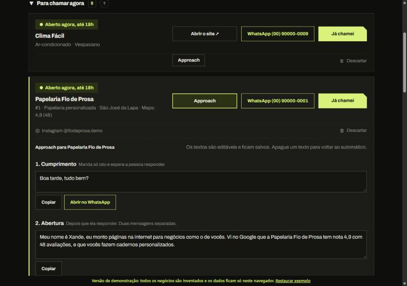
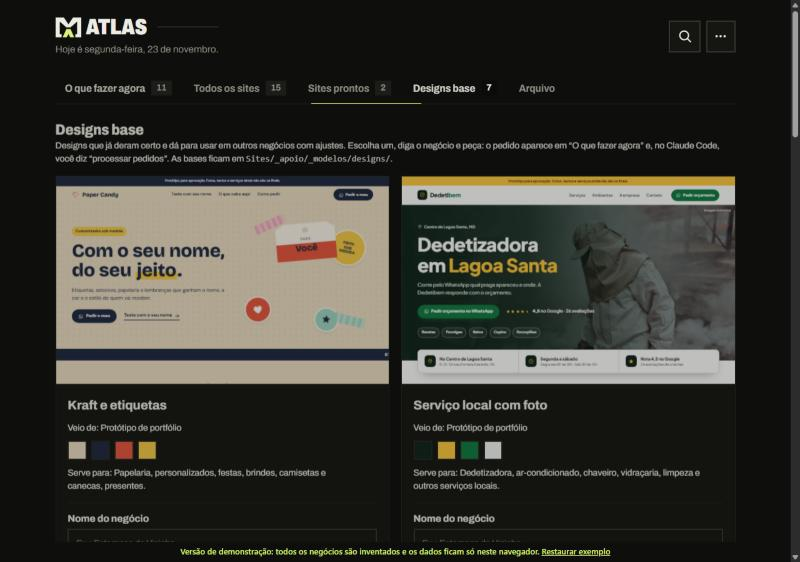

# Atlas

Painel que eu uso todo dia para prospectar pequenos negócios por WhatsApp: ele mostra quem chamar agora, o que dizer para cada um e o que fazer depois da resposta.




## Para quem é e por que existe

Eu vendo páginas na internet para negócios locais que aparecem no Google sem site. Antes, eu anotava os contatos no WhatsApp e no Bloco de Notas, sem controle de quem eu já tinha chamado, quando, nem o que tinha ficado combinado. O Atlas nasceu com outro nome (Bússola), só para listar "onde chamei" e "onde vou chamar", e foi crescendo conforme eu sentia falta de alguma coisa no meu dia a dia.

## O que ele faz

- **O que fazer agora**: fila "Para chamar agora", ordenada por prioridade e pelo horário de funcionamento de cada negócio (só entram os que estão abertos ou vão abrir). Chamo um por um, de cima para baixo. Depois da resposta, ele sai da fila ou vai para a espera.
- **Approach por negócio**: para cada contato, o painel monta o roteiro da conversa (cumprimento, abertura, proposta) usando o que sei dele (ramo, cidade, nota e avaliações no Google Maps). Eu copio, colo no WhatsApp e sigo. Qualquer texto pode ser editado e fica salvo.
- **WhatsApp e Instagram em um clique**, com a mensagem de cumprimento já preenchida.
- **Resultado da conversa**: botão "Já chamei" pergunta como foi (interessado, negociando, sem resposta, não quer...) e agenda a próxima cobrança.
- **Todos os sites, Sites prontos, Designs base e Arquivo**: o catálogo dos protótipos que eu já fiz, com busca e filtros, e uma biblioteca de designs que deram certo, para reaproveitar em outros negócios.
- **Vídeo de demonstração para o WhatsApp**: em vez de mandar link para quem não me conhece (gera desconfiança), mando o arquivo do vídeo. O botão abre o Explorador de Arquivos do Windows com o vídeo já selecionado; é só Ctrl+C e Ctrl+V na conversa.





## Como funciona (o caminho de uma ação)

1. Abro o Atlas. A aba **O que fazer agora** lista os negócios que ainda não chamei e estão abertos.
2. Clico em **Approach** no primeiro da fila. O cartão se expande ali mesmo, sem recarregar a tela, com os textos prontos.
3. Copio o cumprimento e abro o WhatsApp pelo botão do cartão. Quando a pessoa responde, copio a abertura e, se ela se interessar, o vídeo e a proposta.
4. Clico em **Já chamei**, escolho o resultado, e o Atlas grava a data e agenda a cobrança, ou descarta o contato.
5. Tudo que eu mudo é gravado na hora no banco de dados; a tela se atualiza sozinha.

Por baixo, é uma única página HTML. Ela lê e grava duas coleções (`sites` e `pedidos`) em um banco de dados que o claude.ai oferece a cada página publicada, e escuta as mudanças em tempo real. Os textos do Approach são montados no navegador a partir dos dados do contato. Um servidor Node local (`servidor/servidor-local.js`) abre as pastas de vídeo no Explorer, e um script (`video/gera-video.js`) grava os vídeos de rolagem dos sites com o Chrome e o ffmpeg.

## Como foi feito

O Atlas nasceu como uma ferramenta só para mim, não como projeto de portfólio. Por isso eu não li o código dele: o que me importava era o meu trabalho fluir, não entender cada linha. Foi ficando robusto e útil o bastante para eu querer mostrar.

- **O que eu decidi:** o que o sistema faz e o que aparece na tela: a fila ordenada por horário, o texto de cada abordagem, o botão de WhatsApp, o que acontece depois de eu chamar, as abas de catálogo, a biblioteca de designs, não mandar link de vídeo, vídeo sem cursor de mouse e um visual que combina com o do meu [portfólio](https://xandemartinsc.pages.dev/carreira/). Cada função entrou porque eu senti falta dela usando.
- **Como eu peço:** por áudio, explicando o que me incomoda e o que quero no lugar. Quando não sei como resolver, peço opções ao Claude e escolho a que serve ao meu uso. As primeiras sugestões nem sempre eram boas; nesses casos eu dizia como seria o ideal para mim e ele voltava com opções melhores. Discordei dele várias vezes, em design e em correção de bug.
- **O que a IA fez:** o desenho das telas e todo o código (HTML, CSS e JavaScript sem framework, o servidor Node e o gerador de vídeo), escritos com o Claude Code a partir dos meus pedidos.
- **Como foi testado:** no uso diário, no meu trabalho. Quando algo atrapalhava (a tela piscando ao abrir, dois botões um em cima do outro, o vídeo com a faixa correndo rápido demais), eu descrevia o problema e pedia a correção, e a conferência era usar de novo.

Alguns problemas que apareceram no caminho:

| Problema | O que resolveu |
| --- | --- |
| Colar o vídeo copiado no WhatsApp não funcionava | Abrir o Explorer com o arquivo selecionado e colar de lá |
| A faixa de itens rolando ficava 4 vezes mais rápida no vídeo | A gravação é mais lenta que o relógio; as animações infinitas passaram a seguir o relógio do vídeo, quadro a quadro |
| Clicar em Approach recarregava a lista inteira (a tela piscava) | Expandir e recolher o cartão no lugar, sem refazer a lista |
| A tela piscava algumas vezes ao abrir | Tema aplicado antes de desenhar, tela escondida até os dados e a fonte chegarem, e lista refeita só se os dados mudaram |

## Limitações

- O Atlas original usa o banco de dados do claude.ai, então só funciona dentro dele, como página privada. Por isso este repositório traz uma **versão de demonstração** com um banco falso no navegador.
- O servidor local e o gerador de vídeo foram feitos para Windows (usam `explorer.exe`) e para o meu computador.
- O descarte automático de contatos sem resposta só roda com o painel aberto.
- Se eu quiser usar em outros projetos, o próximo passo é tirar o Atlas de dentro do Claude e dar a ele um banco próprio.

## Como rodar a demonstração

Todos os negócios da demonstração são inventados e os dados ficam só no seu navegador.

```powershell
cd demo
python -m http.server 5199
```

Abra `http://localhost:5199/`. Para voltar ao estado inicial, use `http://localhost:5199/?reset`.

Os botões de vídeo só funcionam com o servidor local ligado (`node servidor/servidor-local.js`) e arquivos em `videos/whatsapp/`. A pasta vem vazia.

## Estrutura

```
demo/           Atlas (HTML único) + banco falso em demo-claude.js
servidor/       servidor local que abre o Explorer com o vídeo selecionado
video/          gera-video.js: grava um site rolando em .mp4 (Chrome + ffmpeg)
docs/prints/    imagens usadas neste README
```

## Tecnologias

- **HTML, CSS e JavaScript puros**: uma página só, sem framework, fácil de abrir e de publicar.
- **Banco de dados do claude.ai**: guarda os contatos sem eu precisar montar servidor nem pagar hospedagem.
- **Node.js**: o servidor local e o gerador de vídeo.
- **Chrome (protocolo CDP) e ffmpeg**: o Chrome mostra o site e tira os quadros; o ffmpeg junta os quadros em vídeo.

Os dados de exemplo e os nomes de negócio da demonstração são fictícios.

## Licença

MIT. Veja o arquivo [LICENSE](LICENSE).
